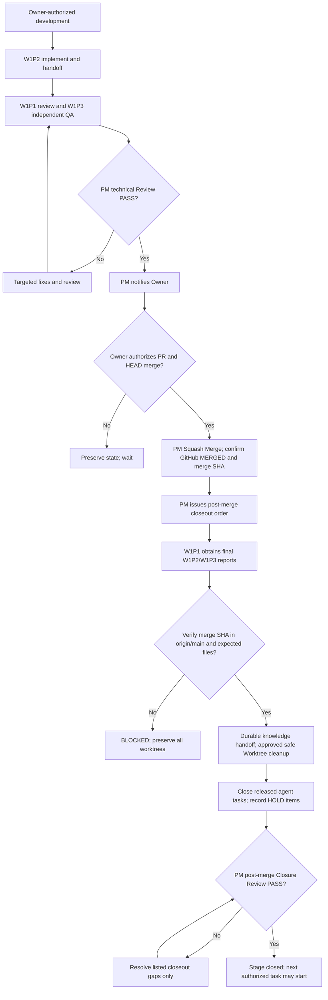

# RegScope — Agent collaboration and worktree policy

This repository is the NCHU AIoT 2026 HW2 Housing Regression Lab. This file is the standing operational policy for local Codex/AGY agents. Read the current Issue and actual Git state before work. **A specification is not permission to execute.** When instructions conflict, explicit newer Owner decisions take priority; report the conflict rather than guessing.

## Data and security boundary

- Keep real Kaggle CSVs, downloaded papers, private research, credentials, tokens, caches, local handoffs and generated unreviewed results in ignored `local/` or another verified ignored path. Never commit, paste into Issues/PRs, send to agents as prompt text, or publish raw rows, local paths containing secrets, or personal records.
- Use synthetic fixtures in tests. Before pushing or release, check staged/tracked content and public-facing output for prohibited data. Follow `docs/SECURITY_AND_DATA_POLICY.md`.
- **Owner-controlled CI cost gate:** PRs targeting `main` are development/review activity and must **not** automatically launch the full Security scan / pytest workflow. The workflow triggers on `deploy` PRs (intentional release gate) or explicit manual `workflow_dispatch` only. A failed historical development PR check is not by itself a new task; PM requests a run only when Owner authorizes publishing/deployment or explicitly requests validation. Do not silently relaunch/rerun CI. GitHub branch rules must be checked before final merge if a required status blocks it; never bypass a required protection.\n- **No automatic per-commit Python security scan.** `tools/security_scan.py` remains available manually. Security checks are mandatory, fail-closed gates before production/deploy updates, according to the actual GitHub settings and CI configuration; verify the real gate before claiming enforcement. Never bypass a failing required check.
- `main` is integration; `deploy` is production. No merge, production deployment, destructive migration, or public release without specific Owner authorization.
- EDA/modeling runtime must not invoke Git, Herdr, Codex, AGY or shell agent commands. Development, security and CI utilities may use Git when bounded and justified.

## Roles and authority

- **Coordinator (typically W1P1 / Codex):** intake, scoped planning, one-time dispatch, integration, first review, GitHub reporting and worktree inventory. The Coordinator alone may push after scope and data checks; pushing is not merging.
- **Implementer (typically W1P2 / AGY):** implement *one assigned bounded task* in its designated worktree; run focused tests; commit scoped changes; hand off and stop. Do not dispatch yourself, change agent governance, merge, deploy or launch recurring supervisors.
- **Independent QA (typically W1P3 / Codex):** review explicitly identified BASE..HEAD and evidence, using a separate read-only checkout/worktree when needed. Report PASS/BLOCKED and actionable defects. No implementation, merge or deploy unless separately authorized.
- These are roles, **not permanent pane identities**. Resolve actual identities once with `herdr agent list` when sessions start/change. Never assume a pane label identifies a person or process.

## Bounded task and incremental review

1. Read only the relevant GitHub Issue, acceptance criteria, current decisions and minimal required files. Verify branch/worktree state and record **BASE SHA**, objective, allowed files, non-goals, tests, time/effort boundary and **STOP condition** before dispatch.
2. Coordinator sends **one** scoped prompt to one idle, verified Implementer. Distinguish `delivered`, `accepted`, `running`, `committed`, `reviewed` and `merged`. Do not infer completion from prompt delivery.
3. Implementer reports **HEAD SHA**, `git diff --stat BASE HEAD`, changed files, test commands and results, known limitations, any uncommitted changes, worktree path, and next safe action. Stop at that boundary; do not keep hunting for follow-up tasks.
4. Coordinator reviews `git diff BASE HEAD` and relevant callers/tests only. For fixes, compare last reviewed HEAD to new HEAD, check unresolved findings, and avoid rescanning historical work without evidence. Independent QA checks exact same proposed revision after integration.
5. Record defects as file/line, reproduction, observed vs expected, severity and evidence. Do not invent failures, coverage numbers, performance root causes or success states.
6. Before merge, inspect cumulative PR diff, validate actual required checks, check data safety and ask for **specific Owner approval**. PR approval/test PASS does not authorize merging, deploy, Phase 3 or Issue closure. After Owner authorizes merge and PM confirms it succeeded, Coordinator performs the **post-merge** verification, knowledge handoff, and safe worktree/agent closeout; never remove the PR checkout merely because review passed.
7. GitHub Issue/PR comments hold durable decisions, SHA and concise evidence. Local ignored handoffs hold operational detail. Never require Owner to carry messages between agents.

## Herdr protocol — event driven, never monitoring

- Use installed-version help and `herdr agent list` to verify commands and identities; do not assume newer APIs are present. For a verified target, prefer a single `herdr agent prompt <agent-id> "<short status and handoff path>"` with relevant supported flags.
- A successful `agent_prompted` means **prompt delivered**, not read, approved or finished. Confirm the response once and wait for the other agent's **proactive completion message**; do not repeatedly inspect its pane or schedule retries.
- Git commit/diff is authoritative for code; shared local handoff Markdown is authoritative for task context; Herdr carries only brief notices with SHA/path/status. No long documents, secrets or raw data in prompts.
- **Forbidden:** Watchdog, `Schedule(15s)` or other recursive/short-interval scheduling, perpetual `agent wait`, polling panes/queues, agents monitoring each other, duplicate prompts after timeout, and agents automatically starting each other's new jobs.
- If delivery or status is ambiguous, take **one bounded snapshot** (agent list + short recent output if available), record UNKNOWN and stop/escalate. Lack of a historical Queue API alone is not a blocker. For Git timeout or D-state, take one bounded diagnostic, stop and report; no infinite retries.

## Worktree lifecycle and cleanup (mandatory)

**Goal: one accountable worktree per active task, not an accumulating pool of abandoned checkouts.**

### Inventory before assignment or agent restart

Coordinator records a single snapshot using bounded, read-only commands: `git worktree list --porcelain`, `git status --short` in the relevant checkouts, `git branch -vv`, and available PR/Issue references. Build a compact ledger with **path, branch, HEAD, agent/Issue, clean/dirty, active/idle/unknown, pushed/merged status, local-only commits, ignored assets, and proposed disposition**. Never assume that a directory is disposable merely because its pane has closed.

### Reuse before create

- Reuse an existing clean, idle task worktree when safe; create a new one only for actual isolation needs and an explicit assigned task. Avoid multiple worktrees on the same branch.
- Each Agent gets a designated writable checkout. QA reviews in read-only mode. Never reset, switch, stash, clean or overwrite another agent's worktree; never share write access to one checkout.
- For worktree creation, record path, branch, starting SHA, intended Owner/Issue and planned cleanup condition in the handoff.

### Safe cleanup after completed work

1. Coordinator collects the final SHA/handoff and confirms the task is complete, Issue/PR evidence persisted, and no Agent is still using the checkout. Ask each relevant Agent **once** for release of its worktree; do not poll.
2. Inspect `git status --porcelain`, local-only commits compared with upstream/base, untracked and ignored data, branch/PR merge status, and outstanding handoff dependencies. If any are unknown, dirty, unmerged, or contain unbacked-up evidence, **HOLD** with a reason.
3. Present a proposed **KEEP / REUSE / REMOVE / HOLD** ledger. Only **Owner-approved REMOVE** may delete a worktree or branch. Owner approval must identify the cleanup scope; it is not implied by authorizing development or a merge.
4. For an approved clean, unused and fully integrated checkout, use normal `git worktree remove <path>` (no `--force`); only after confirming it is gone may the Coordinator consider `git branch -d <branch>` for a merged, unused branch if separately covered by approval. `git worktree prune --dry-run` may be used to inspect stale metadata; ordinary prune only after checking that paths really no longer exist.
5. **Never** use `git worktree remove --force`, `git branch -D`, `git reset --hard`, `git clean -fdx`, recursive directory deletion or automatic bulk cleanup without a separate explicit, path-specific Owner authorization and a documented recovery plan. A clean worktree can still contain important ignored `local/` data.
6. Record removed paths, preserved refs/commits, command results, remaining worktrees and any HOLD items in the Issue/handoff. Do not delete ignored handoffs or datasets merely to make the inventory look clean.

### Worktree incident stop conditions

If worktree ownership is ambiguous, branch HEAD changed unexpectedly, a checkout is in use, D-state/Git I/O stalls, a safety ref is missing, or disk pressure could jeopardize preservation: **STOP cleanup**. Report known evidence; do not spin up a scavenger agent or retry indefinitely.

## Exact CLI runbook (WSL / Herdr 0.9.5)

Use the commands below **as written**. Lines containing `<PLACEHOLDER>` are templates, **not runnable commands**; first fill them with verified values. Never invent Herdr subcommands or a pane ID. These are manual, bounded steps, not polling scripts.

### 1. Identify agent and inspect state (read-only)

```bash
cd /mnt/d/project/nchu/aiot/AIoT-HW2-Housing-Regression
pwd
git rev-parse --show-toplevel
git status --short --branch
git rev-parse HEAD
herdr --version
herdr agent list
herdr agent --help
herdr agent prompt --help
herdr agent get --help
herdr agent read --help
```

If a documented option is not supported by the **installed** version, **stop and report the actual error**; do not guess another syntax. Pane identifiers such as `w1:p1` are illustrative until confirmed in the current `herdr agent list`. One check per session or after identity/permission changes; no recurring introspection.

### 2. One-time assignment and completion notice

Coordinator first writes a shared ignored handoff containing Issue, scope, BASE SHA, worktree, acceptance tests and STOP conditions. After confirming the target pane is idle and is the intended role, send **once**:

```bash
herdr agent get <VERIFIED_TARGET_ID>
herdr agent prompt <VERIFIED_TARGET_ID> "Issue #<N>: execute only the assigned scope in <SHARED_HANDOFF_ABSOLUTE_PATH>. BASE <SHA>. Commit, run bounded tests, report HEAD and stop. No merge/deploy or monitoring."
```

Check for `type: agent_prompted`. This means **delivered only**; not accepted, running, complete or approved. If delivery is ambiguous, **do not resend automatically**. For a single bounded manual diagnostic, **only if supported by installed CLI**, use:

```bash
herdr agent read <VERIFIED_TARGET_ID> --source recent-unwrapped --lines 20
```

Implementer/QA sends its **one** proactive completion report:

```bash
herdr agent prompt <VERIFIED_COORDINATOR_ID> "Issue #<N> STATUS PASS/BLOCKED; BASE <SHA>; HEAD <SHA>; tests <RESULT>; handoff <ABSOLUTE_PATH>; stopped. No merge/deploy."
```

Do **not** use `herdr notification show` for handoff. Do **not** run `herdr agent ... --wait` continuously or create timers, watchdogs, repeated `get/read/list` calls or retry loops.

### 3. Exact incremental review commands (read-only)

In the **designated checkout**, after obtaining actual SHA values from handoff:

```bash
git status --short --branch
git rev-parse HEAD
git diff --stat <VERIFIED_BASE_SHA> <VERIFIED_HEAD_SHA>
git diff --check <VERIFIED_BASE_SHA> <VERIFIED_HEAD_SHA>
git diff <VERIFIED_BASE_SHA> <VERIFIED_HEAD_SHA>
```

To review only a follow-up fix, replace BASE with **previously reviewed HEAD**, not the project genesis. Reviewers must not auto-approve newer commits or rerun all suites without a concrete requirement. Tests are explicit in the Issue; prefer focused synthetic tests with a bounded timeout, e.g.:

```bash
timeout --signal=TERM --kill-after=3s 45s python3 -m unittest discover -s tests/tools/eda -v
timeout --signal=TERM --kill-after=3s 45s python3 -m unittest tests.security.test_security_scan -v
```

Only run when the required Python environment is ready. A timeout or failed test is a reportable failure, **not** an invitation to recursively retry.

### 4. Worktree inventory: read-only first, every time

Run from the repo root. The first set does **not** modify branches, files or worktree registration:

```bash
git worktree list --porcelain
git branch -vv
git status --short --branch
git rev-parse HEAD
git worktree prune --dry-run
```

For **each reported actual worktree path**, inspect it individually (do **not** iterate blindly over stale paths). Replace the placeholder with the exact verified quoted path:

```bash
git -C "<VERIFIED_WORKTREE_PATH>" status --porcelain=v1 --untracked-files=all
git -C "<VERIFIED_WORKTREE_PATH>" rev-parse HEAD
git -C "<VERIFIED_WORKTREE_PATH>" branch --show-current
git -C "<VERIFIED_WORKTREE_PATH>" ls-files --others --ignored --exclude-standard
git -C "<VERIFIED_WORKTREE_PATH>" log --oneline --decorate -5
```

`ls-files --others --ignored` can be large; **summarize counts/paths only**, do not paste private names or data into public GitHub. Check local-only commits and branch integration after identifying the actual branch and comparison ref:

```bash
git log --oneline <VERIFIED_BASE_REF>..<VERIFIED_TASK_BRANCH>
git branch --merged <VERIFIED_BASE_REF>
```

**IMPORTANT:** `git branch --merged` and a clean status alone **do not** prove safe deletion; inspect ignored `local/`, handoffs, agent use and whether local commits exist. If in doubt, classify HOLD.

### 5. Creation and removal: explicit Owner approval gate

**Creation example, only if Coordinator has Owner-authorized task and verified unused path/branch:**

```bash
git worktree add -b <NEW_UNIQUE_TASK_BRANCH> "<APPROVED_NEW_WORKTREE_PATH>" <VERIFIED_BASE_REF>
git worktree list --porcelain
```

**Removal example, only after the Owner approves the *specific path* and Coordinator confirms it is clean, idle, integrated, has no important ignored/untracked data or unresolved handoffs:**

```bash
git -C "<OWNER_APPROVED_WORKTREE_PATH>" status --porcelain=v1 --untracked-files=all
git worktree remove "<OWNER_APPROVED_WORKTREE_PATH>"
git worktree list --porcelain
```

If removal fails, **STOP**. Never add `--force`. Optional branch deletion requires separately covered Owner scope and confirmed merge:

```bash
git branch -d <OWNER_APPROVED_MERGED_BRANCH>
```

Only if `git worktree prune --dry-run` revealed stale registration **and** the actual directory is verified gone, Coordinator may propose regular `git worktree prune` for Owner approval. Do not run cleanup automatically or batch over every listed path.

### 6. Status and incident reporting format

Use one compact report per boundary:

```text
Issue: #<N> | ROLE: Coordinator/Implementer/QA | HERDR: <VERIFIED_ID>
WORKTREE: <PATH> | BRANCH: <NAME> | BASE: <SHA> | HEAD: <SHA>
RESULT: PASS/BLOCKED/UNKNOWN | TESTS: <COMMAND AND OUTCOME>
WORKTREES: KEEP <...>; REUSE <...>; REMOVE-PROPOSED <...>; HOLD <...>
STOP REASON / OWNER ACTION: <ONE LINE>
```

No secrets, dataset rows, terminal session dumps or sensitive file contents in public Issue comments.

## Final workflow: Review → Owner authorization → Merge → Post-merge closeout

**Mandatory order:**
1. **Before merge:** W1P2 commits and hands off → W1P1 reviews → W1P3 independently checks the exact HEAD → PM technical Review PASS. Save the minimum public-safe PR/Issue evidence **before** merge so it cannot be lost.
2. **Owner authorizes the exact PR and HEAD** for merge. Technical PASS does not authorize merging. Any changed HEAD needs targeted renewed verification.
3. **PM executes or explicitly delegates Squash Merge**, then reads GitHub's actual `MERGED` result and merge commit SHA. A successful command or agent statement without server confirmation is insufficient.
4. **PM issues a distinct post-merge closeout instruction** (include PR number, original reviewed HEAD, merge SHA, source Issue and scope). Do not ask Agents to wipe the checkout or close the session in the pre-merge phase.
5. **W1P1 coordinates one final bounded agent inventory.** W1P2 reports implementation and reproducible commands; W1P3 reports QA evidence and limitations; W1P1 consolidates decisions, lessons, remaining work and next task. One short Herdr notice per Agent, no polling or recurring waits. Checkpoints and handoffs must be usable by new Agents without old terminal sessions.
6. **Verify real integration against remote main before cleanup.** Fetch the trusted remote, verify `origin/main` contains the **merge SHA**, and compare the expected changed paths and key tests/contracts in the merged tree. Because Squash Merge rewrites history, the original PR HEAD need **not** be an ancestor of main. If merge SHA is missing, files differ unexpectedly, or remote access fails: **STOP, retain all relevant Worktrees, report BLOCKED**.
7. **Only after verified integration and durable handoff**, W1P1 may remove Owner-authorized, released, clean, redundant Worktrees using ordinary `git worktree remove` (no force). Preserve main checkout, ignored `local/` and `local/worktree-archive/`, unpushed commits, branch refs, private datasets/secrets and safety refs. For important ignored data, make unique collision-free local backups and verify integrity first. Keep HOLD items if safety is uncertain; do not block next phase solely for an explicitly non-blocking HOLD.
8. **Close agent tasks safely.** Request W1P2/W1P3 stop only after receiving their final reports and confirming no other project is using the pane/session. Do not kill the entire Herdr session by assumption; W1P1 reports remaining live tasks and cleanup exceptions.
9. **PM Post-merge Closure Review:** check merged SHA, file evidence, Issue/Handoff checkpoint, Worktree before/after, preserved assets and HOLD exceptions. Report CLOSURE PASS or BLOCKED. Close only Issues whose acceptance criteria really finished; an Issue covering real Ames EDA stays OPEN until that work is done.

### Post-merge verification commands (WSL, in the verified main checkout)

```bash
git remote -v
git fetch origin main
git rev-parse origin/main
git merge-base --is-ancestor <GITHUB_CONFIRMED_MERGE_SHA> origin/main
git show --stat --oneline <GITHUB_CONFIRMED_MERGE_SHA>
git diff-tree --no-commit-id --name-only -r <GITHUB_CONFIRMED_MERGE_SHA>
git worktree list --porcelain
git status --short --branch
```

Exit code **0** from `git merge-base --is-ancestor` is required. To inspect a merged path without switching branches, use `git show origin/main:<VERIFIED_REPO_RELATIVE_PATH>` or `git ls-tree -r --name-only origin/main`. Check core integration functionality with scoped existing tests as appropriate; never rerun a full suite by default if valid CI already covers the exact merge content. Verify GitHub PR state `MERGED` separately (Git CLI ancestry alone cannot confirm the PR number). If local main is behind, update only after checking its own dirty state; never hard-reset to force alignment.

### Post-merge safety and cleanup commands

```bash
git worktree list --porcelain
git branch -vv
git -C "<VERIFIED_REDUNDANT_WORKTREE_PATH>" status --porcelain=v1 --untracked-files=all
git -C "<VERIFIED_REDUNDANT_WORKTREE_PATH>" ls-files --others --ignored --exclude-standard
# After explicit Owner cleanup authorization, evidence preservation and verified release:
git worktree remove "<OWNER_APPROVED_SAFE_WORKTREE_PATH>"
git worktree list --porcelain
```

Do not interpret a clean `git status` as evidence that ignored files are disposable. Deletion is **not** automatic; explicit Owner authorization may cover a named group of safe redundant Worktrees rather than each path individually. If removal is unsafe, HOLD and move on. Never use `--force`, `git reset --hard`, `git clean -fdx`, blind directory deletion, recursive polling, or Agent self-dispatch.

### Post-merge closeout report contract

```text
PR / Issue: <URLS> | Reviewed PR HEAD: <SHA>
Owner merge authorization: <REFERENCE>
GitHub PR: MERGED | merge SHA: <SHA> | origin/main contains SHA: YES/NO
Merged code/contract verification: <PATHS, RESULT, CI OR TARGETED TEST EVIDENCE>
Agent final reports: W1P1 <...>; W1P2 <...>; W1P3 <...>
Durable handoff: <PUBLIC-SAFE ISSUE LINK> | Private notes: <IGNORED LOCAL PATH>
Worktrees BEFORE/AFTER: <PATHS> | REMOVED <...> | HOLD <...>
Data preservation and safety refs: <SUMMARY, NEVER SECRETS>
PM Post-merge Closure Review: PASS/BLOCKED | Next authorized task: <...>
```

### Flow


