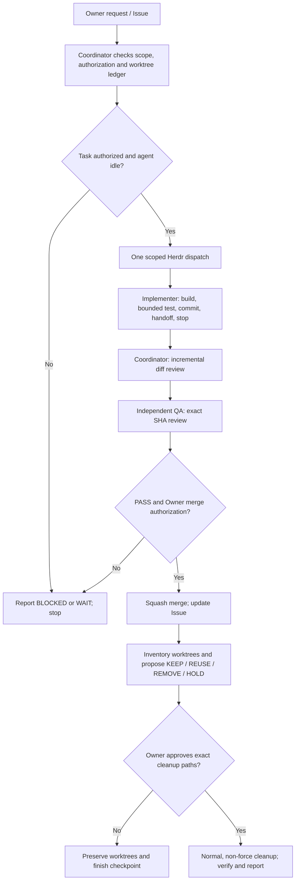

# RegScope — Agent collaboration and worktree policy

This repository is the NCHU AIoT 2026 HW2 Housing Regression Lab. This file is the standing operational policy for local Codex/AGY agents. Read the current Issue and actual Git state before work. **A specification is not permission to execute.** When instructions conflict, explicit newer Owner decisions take priority; report the conflict rather than guessing.

## Data and security boundary

- Keep real Kaggle CSVs, downloaded papers, private research, credentials, tokens, caches, local handoffs and generated unreviewed results in ignored `local/` or another verified ignored path. Never commit, paste into Issues/PRs, send to agents as prompt text, or publish raw rows, local paths containing secrets, or personal records.
- Use synthetic fixtures in tests. Before pushing or release, check staged/tracked content and public-facing output for prohibited data. Follow `docs/SECURITY_AND_DATA_POLICY.md`.
- **No automatic per-commit Python security scan.** `tools/security_scan.py` remains available manually. Security checks are mandatory, fail-closed gates before production/deploy updates, according to the actual GitHub settings and CI configuration; verify the real gate before claiming enforcement. Never bypass a failing required check.
- `main` is integration; `deploy` is production. No merge, production deployment, destructive migration, or public release without specific Owner authorization.
- EDA/modeling runtime must not invoke Git, Herdr, Codex, AGY or shell agent commands. Development, security and CI utilities may use Git when bounded and justified.

## Roles and authority

- **Coordinator (typically W1P1 / Codex):** intake, scoped planning, one-time dispatch, integration, first review, GitHub reporting and worktree inventory. The Coordinator alone may push after scope and data checks; pushing is not merging.
- **Implementer (typically W1P2 / AGY):** implement *one assigned bounded task* in its designated worktree; run focused tests; commit scoped changes; hand off and stop. Do not dispatch yourself, change agent governance, merge, deploy or launch recurring supervisors.
- **Independent QA (typically W1P3 / Codex):** review explicitly identified BASE..HEAD and evidence, using a separate read-only checkout/worktree when needed. Report PASS/BLOCKED and actionable defects. No implementation, merge or deploy unless separately authorized.
- These are roles, **not permanent pane identities**. Resolve actual identities once with `herdr agent list` when sessions start/change. Never assume a pane label identifies a person or process.

## Bounded task and incremental review

1. Read only the relevant GitHub Issue, acceptance criteria, current decisions and minimal required files. Verify branch/worktree state and record **BASE SHA**, objective, allowed files, non-goals, tests, time/effort boundary and **STOP condition** before dispatch.
2. Coordinator sends **one** scoped prompt to one idle, verified Implementer. Distinguish `delivered`, `accepted`, `running`, `committed`, `reviewed` and `merged`. Do not infer completion from prompt delivery.
3. Implementer reports **HEAD SHA**, `git diff --stat BASE HEAD`, changed files, test commands and results, known limitations, any uncommitted changes, worktree path, and next safe action. Stop at that boundary; do not keep hunting for follow-up tasks.
4. Coordinator reviews `git diff BASE HEAD` and relevant callers/tests only. For fixes, compare last reviewed HEAD to new HEAD, check unresolved findings, and avoid rescanning historical work without evidence. Independent QA checks exact same proposed revision after integration.
5. Record defects as file/line, reproduction, observed vs expected, severity and evidence. Do not invent failures, coverage numbers, performance root causes or success states.
6. Before merge, inspect cumulative PR diff, validate actual required checks, check data safety and ask for **specific Owner approval**. PR approval/test PASS does not authorize merging, deploy, Phase 3 or Issue closure.
7. GitHub Issue/PR comments hold durable decisions, SHA and concise evidence. Local ignored handoffs hold operational detail. Never require Owner to carry messages between agents.

## Herdr protocol — event driven, never monitoring

- Use installed-version help and `herdr agent list` to verify commands and identities; do not assume newer APIs are present. For a verified target, prefer a single `herdr agent prompt <agent-id> "<short status and handoff path>"` with relevant supported flags.
- A successful `agent_prompted` means **prompt delivered**, not read, approved or finished. Confirm the response once and wait for the other agent's **proactive completion message**; do not repeatedly inspect its pane or schedule retries.
- Git commit/diff is authoritative for code; shared local handoff Markdown is authoritative for task context; Herdr carries only brief notices with SHA/path/status. No long documents, secrets or raw data in prompts.
- **Forbidden:** Watchdog, `Schedule(15s)` or other recursive/short-interval scheduling, perpetual `agent wait`, polling panes/queues, agents monitoring each other, duplicate prompts after timeout, and agents automatically starting each other's new jobs.
- If delivery or status is ambiguous, take **one bounded snapshot** (agent list + short recent output if available), record UNKNOWN and stop/escalate. Lack of a historical Queue API alone is not a blocker. For Git timeout or D-state, take one bounded diagnostic, stop and report; no infinite retries.

## Worktree lifecycle and cleanup (mandatory)

**Goal: one accountable worktree per active task, not an accumulating pool of abandoned checkouts.**

### Inventory before assignment or agent restart

Coordinator records a single snapshot using bounded, read-only commands: `git worktree list --porcelain`, `git status --short` in the relevant checkouts, `git branch -vv`, and available PR/Issue references. Build a compact ledger with **path, branch, HEAD, agent/Issue, clean/dirty, active/idle/unknown, pushed/merged status, local-only commits, ignored assets, and proposed disposition**. Never assume that a directory is disposable merely because its pane has closed.

### Reuse before create

- Reuse an existing clean, idle task worktree when safe; create a new one only for actual isolation needs and an explicit assigned task. Avoid multiple worktrees on the same branch.
- Each Agent gets a designated writable checkout. QA reviews in read-only mode. Never reset, switch, stash, clean or overwrite another agent's worktree; never share write access to one checkout.
- For worktree creation, record path, branch, starting SHA, intended Owner/Issue and planned cleanup condition in the handoff.

### Safe cleanup after completed work

1. Coordinator collects the final SHA/handoff and confirms the task is complete, Issue/PR evidence persisted, and no Agent is still using the checkout. Ask each relevant Agent **once** for release of its worktree; do not poll.
2. Inspect `git status --porcelain`, local-only commits compared with upstream/base, untracked and ignored data, branch/PR merge status, and outstanding handoff dependencies. If any are unknown, dirty, unmerged, or contain unbacked-up evidence, **HOLD** with a reason.
3. Present a proposed **KEEP / REUSE / REMOVE / HOLD** ledger. Only **Owner-approved REMOVE** may delete a worktree or branch. Owner approval must identify the cleanup scope; it is not implied by authorizing development or a merge.
4. For an approved clean, unused and fully integrated checkout, use normal `git worktree remove <path>` (no `--force`); only after confirming it is gone may the Coordinator consider `git branch -d <branch>` for a merged, unused branch if separately covered by approval. `git worktree prune --dry-run` may be used to inspect stale metadata; ordinary prune only after checking that paths really no longer exist.
5. **Never** use `git worktree remove --force`, `git branch -D`, `git reset --hard`, `git clean -fdx`, recursive directory deletion or automatic bulk cleanup without a separate explicit, path-specific Owner authorization and a documented recovery plan. A clean worktree can still contain important ignored `local/` data.
6. Record removed paths, preserved refs/commits, command results, remaining worktrees and any HOLD items in the Issue/handoff. Do not delete ignored handoffs or datasets merely to make the inventory look clean.

### Worktree incident stop conditions

If worktree ownership is ambiguous, branch HEAD changed unexpectedly, a checkout is in use, D-state/Git I/O stalls, a safety ref is missing, or disk pressure could jeopardize preservation: **STOP cleanup**. Report known evidence; do not spin up a scavenger agent or retry indefinitely.

## Completion and restart handoff

Coordinator posts a concise checkpoint to the relevant Issue with BASE/HEAD, review and test evidence, active Issue/PR, outstanding blockers, agent role-to-Herdr mapping (if currently verified), and the worktree ledger. On restart, each agent reads this checkpoint and its assigned local handoff; do not re-run historical work by default.

