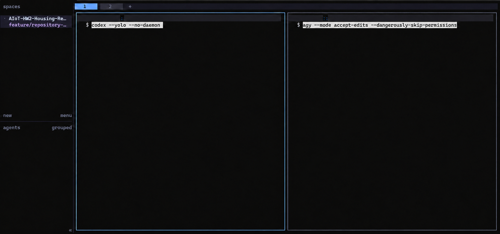
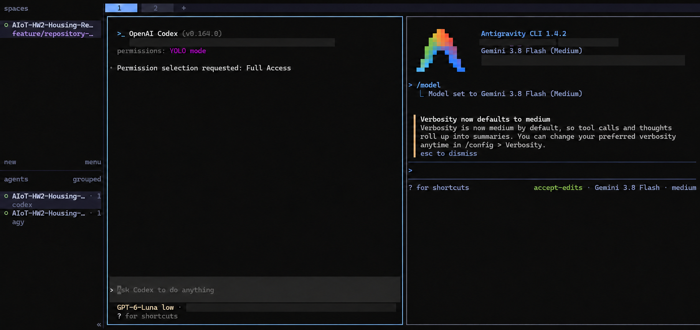

# Developer Setup

This guide covers the initial WSL and Python setup, plus the agent CLI modes shown in the maintainer setup screenshots. Keep account credentials outside the repository.

## Open the project in WSL

From a WSL terminal, enter the repository checkout. For a Windows checkout on drive `D:`, WSL normally mounts it under `/mnt/d`:

```bash
cd /mnt/d/path/to/AIoT-HW2-Housing-Regression
pwd
git status --short --branch
```

Use a `feature/*` branch for changes and submit a pull request to `main`. Reserve `deploy` for reviewed production releases.

## Prepare Python tools

```bash
python3 -m venv .venv
source .venv/bin/activate
python -m pip install --upgrade pip
python -m pip install -r tools/research_collector/requirements.txt
python -m pip install pre-commit
pre-commit install
```

Run the repository checks before opening a pull request:

```bash
python tools/security_scan.py --all
python -m unittest discover -s tests/security -v
```

## Agent CLI launch modes

The screenshots below show the maintainer's WSL launch commands:





```bash
codex --yolo --no-daemon
agy --mode accept-edits --dangerously-skip-permissions
```

`--no-daemon` starts the interactive Codex CLI without its shared background server. Codex `--yolo` bypasses approval prompts and sandboxing. For ordinary repository work, prefer the scoped mode:

```bash
codex --no-daemon --sandbox workspace-write --ask-for-approval on-request
```

In Antigravity CLI, `--mode accept-edits` automatically approves workspace file edits; by itself it still asks before terminal commands. `--dangerously-skip-permissions` auto-approves tool permission requests. These flags change tool approvals; they do not bypass account sign-in, billing, or organizational policy.

The full-access commands can read and modify files available to the WSL user. `.gitignore` prevents `local/` files from being committed, but it does not prevent an agent from reading them. Run broad-permission agents only in a clean, isolated worktree that contains no local datasets, internal notes, or credentials. Keep `local/` in the main checkout and use separate worktrees for agent tasks.

See the [Codex CLI reference](https://learn.chatgpt.com/docs/developer-commands?surface=cli) and [Antigravity CLI modes](https://www.agy.dev/docs/cli/modes/) for current flag behavior.
