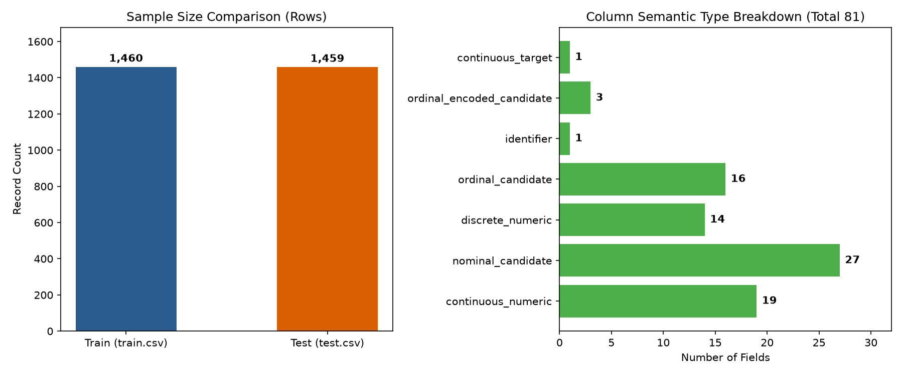
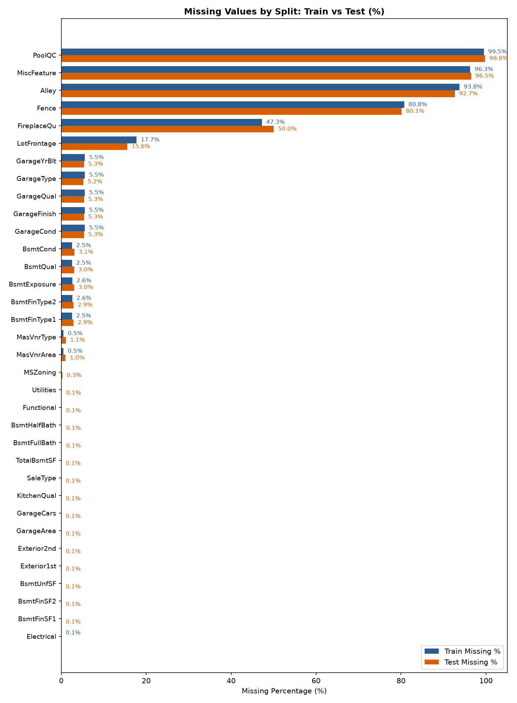
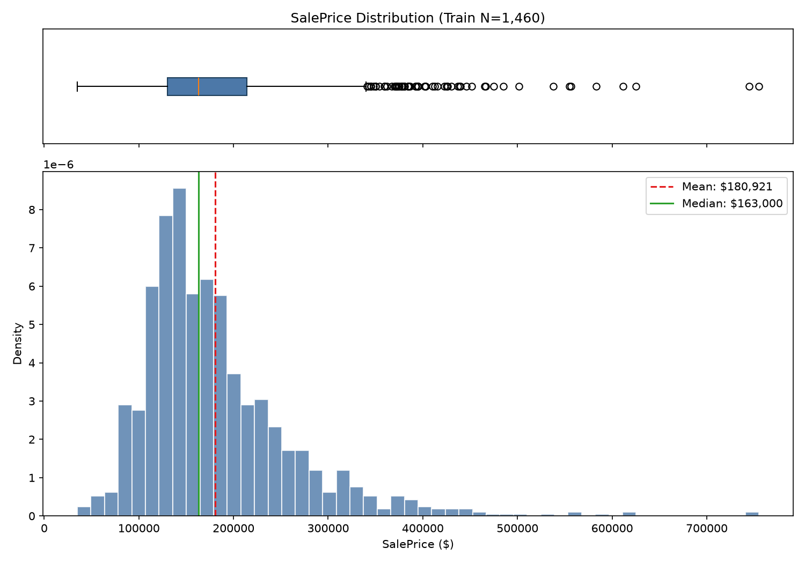
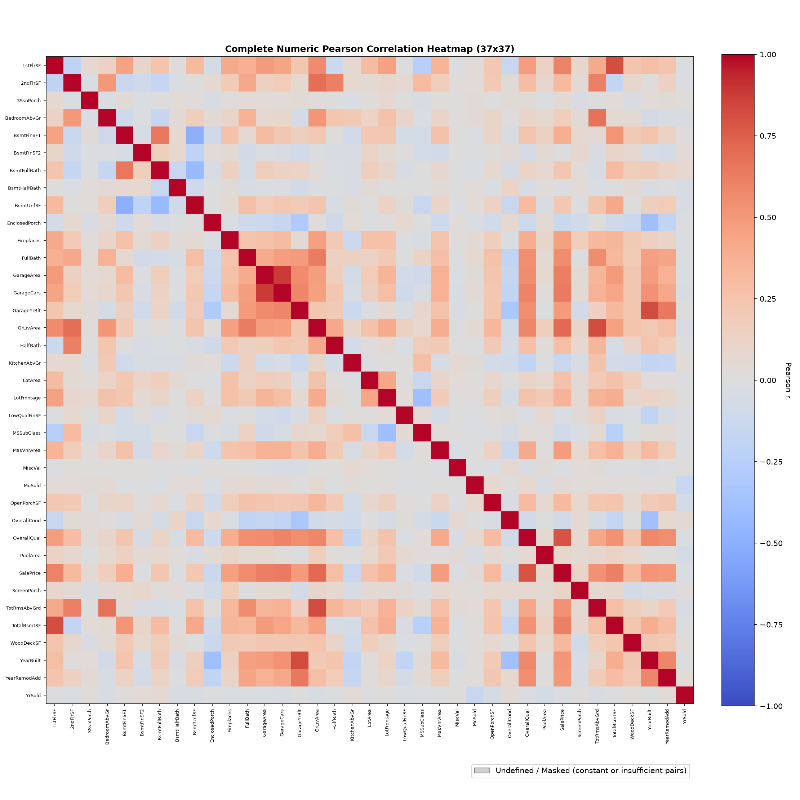

# CRISP-DM Phase 2 — Data Understanding

**Project:** NCHU AIoT 2026 HW2 Housing Regression
**Parent Epic:** [#4 — HW2 Regression Research](https://github.com/wupojung/AIoT-HW2-Housing-Regression/issues/4)
**Work item:** [#9 — Ames Housing — Data Understanding](https://github.com/wupojung/AIoT-HW2-Housing-Regression/issues/9)
**Phase status:** COMPLETED (Phase 2 Empirical Descriptive Profiling completed; Independent QA PASSED; PM Review and Epic Closeout PENDING)
**Data inspection date:** 2026-10-24
**Owner download / access date:** UNKNOWN / UNRECORDED (local package verified via SHA-256 integrity match on 2026-10-24)

---

## 執行摘要 (Executive Summary)

本文件為 NCHU AIoT 2026 HW2 房價迴歸研究專案之 CRISP-DM Phase 2（資料理解，Data Understanding）成果報告。技術層面之實證描述性統計剖析已全數完成，獨立 QA 審查檢驗通過（QA PASSED），目前處於等待專案管理審查與 Epic 結案狀態（PM Review & Closeout PENDING）。

### 1. 研究資料總覽 [Verified / 已驗證]
- **競賽來源與授權決議**：本研究採用 Kaggle [House Prices: Advanced Regression Techniques](https://www.kaggle.com/competitions/house-prices-advanced-regression-techniques) 官方競賽資料包。資料存放於私有 ignored `local/datasets/`，經 SHA-256 完整雜湊比對與官方套件一致。Owner 於 2026-10-24 檢查點決議中正式確認取得資料管道合規並同意 Kaggle 競賽規則，條款狀態已由先前的 OPEN 正式更新為 Verified。
- **資料維度與盲測隔離**：
  - 訓練集（`train.csv`）：1,460 列 × 81 欄，包含連續型目標變數 `SalePrice`。
  - 測試集（`test.csv`）：1,459 列 × 80 欄，無目標變數，完全維護 Kaggle 競賽之盲測隔離邊界。
  - 解釋變數規模：排除識別碼 `Id` 與目標變數 `SalePrice` 後，具備 79 個候選預測特徵（完全符合且遠超課程要求的至少 14 個特徵）。
- **識別碼唯一性**：`Id` 欄位於訓練集與測試集內各自唯一（重複數均為 0），兩集合間交集數精確為 0；`sample_submission.csv` 之 ID 序列及順序與測試集完全吻合。
- **資料字典全面對照**：全數 79 個特徵定義與官方 `data_description.txt` 完整交叉對照（77 項完全吻合，2 項為已記錄欄位別名：`BedroomAbvGr` 對應 `Bedroom`、`KitchenAbvGr` 對應 `Kitchen`）。

### 2. 主要統計發現 [Verified / 已驗證]
- **目標變數分佈特性**：目標變數 `SalePrice` 邊際分佈呈現明顯右偏（正偏態）。樣本均值為 $180,921.20，中位數為 $163,000.00，標準差為 $79,442.50，極端價格延伸至 $755,000.00。未校正之母體三階動差偏態係數（population-moment skewness）為 1.881。依據 1.5 × IQR 準則識別出 61 個上界候選離群值（超過上邊界 $340,037.50）。
- **關鍵線性相關特徵**：在兩兩完整觀測值下，與 `SalePrice` 展現最高成對線性相關（Pearson $r$）之特徵包括：建物整體建材品質評分 `OverallQual` ($r = 0.7910$)、地面居住面積 `GrLivArea` ($r = 0.7086$)、車庫容納車數 `GarageCars` ($r = 0.6404$)、車庫面積 `GarageArea` ($r = 0.6234$)、地下室總面積 `TotalBsmtSF` ($r = 0.6136$) 與一樓面積 `1stFlrSF` ($r = 0.6059$)。
- **物理結構性缺失之辨識**：原始資料集缺失值以字面值 `"NA"` 編碼（訓練集 6,965 個、測試集 7,000 個，全表無空白儲存格）。依據資料字典，有 15 個欄位之 `"NA"` 屬於房屋未具備該項設施之「物理結構性不存在」（如無泳池 `PoolQC` 99.52%、無雜項設施 `MiscFeature` 96.30%、無巷道通聯 `Alley` 93.77%、無圍欄 `Fence` 80.75%、無壁爐 `FireplaceQu` 47.26%、無車庫相關 5.55%、無地下室相關 2.53% 等），不可直接視為觀測遺漏。
- **特徵多重共線性與共缺現象**：數值解釋變數間存在顯著線性共線性，如 `GarageCars` 與 `GarageArea` ($r = 0.882$)、`GrLivArea` 與 `TotRmsAbvGrd` ($r = 0.825$)、`TotalBsmtSF` 與 `1stFlrSF` ($r = 0.820$)。車庫與地下室各群組內部亦呈現高度共同缺失（Co-missingness）聚集現象。

### 3. 研究限制與陳述邊界 [Verified & Assumed]
- **相關非因果界線 [Verified]**：本報告所有 Pearson 相關係數僅度量雙變數之成對線性關聯強度，不代表任何因果驅動關係（Causality），亦不代表該特徵在多元迴歸模型中必然具備獨立邊際定價能力。
- **目標偏態與殘差界線 [Assumed / 待檢定假說]**：`SalePrice` 邊際分佈之右偏與離群值，僅描述未條件化之目標變數形態，不等同於模型殘差必然違背常態性或等分散性假定。此觀察僅作為 Phase 3 探索對數轉換之實驗動機，非強制先驗決策。
- **地端私有性與圖表資產邊界 [Verified]**：自動化管線共產出 87 筆圖表項目（每項具備 PNG 與 SVG 雙格式，共 174 個影像圖檔）及 7 項結構化清單與分析報告。本公開報告僅精選審查 4 組彙總性代表圖表項目（FIG-01、FIG-02、FIG-03、FIG-06，共 8 份影像檔案）；其餘 4 筆總覽圖與 79 筆單欄位分布圖（合計 83 筆、166 份圖檔），以及原始列資料，均保留於 ignored `local/`，不提交至公開儲存庫。

### 4. Phase 3 待辦與候選假設 (Candidate Hypotheses) [Assumed / 待檢定假說]
Phase 2 嚴格遵守描述性研究邊界，未執行任何資料插補、特徵工程、訓練集/測試集分割或模型訓練。後續 Phase 3（資料準備）將系統性檢定以下候選假說：
1. **目標對數轉換假說**：評估採用 $\log(1 + \text{SalePrice})$ 建模是否能穩定變異數、優化 Kaggle RMSLE 競賽指標，並落實反向還原計算以回報課程要求的 RMSE、MAE 與 $R^2$。
2. **結構缺失分離插補假說**：針對 15 個結構性缺失特徵編碼為獨立類別等級（`"None"`）或 0 數值，而其餘真實未記錄缺失則嚴格限制於交叉驗證訓練折內以中位數或眾數插補，杜絕資料洩漏。
3. **類別特徵編碼比較假說**：評估評等類有序特徵（如 `OverallQual`, `ExterQual`）採用有序整數映射，與名義類特徵採用 One-Hot 或目標編碼在驗證集上的表現差異。
4. **多重共線性管理假說**：在 Phase 4 迴歸建模中，針對高度共線特徵對評估正則化懲罰（Ridge, Lasso, ElasticNet）或特徵降維/複合特徵建構之成效。

---

## 1. Gate summary

| Status | Finding |
|---|---|
| **Verified** | Kaggle official competition Data source page verified. Local dataset package provided under ignored `local/datasets/` with byte-for-byte SHA-256 hash match (`train.csv`, `test.csv`, `data_description.txt`, `sample_submission.csv`). |
| **Verified** | Continuous target `SalePrice` present in `train.csv` (1,460 rows × 81 columns); target absent from `test.csv` (1,459 rows × 80 columns), preserving competition holdout isolation. Explanatory predictor count: exactly 79 (excluding `Id` and `SalePrice`), satisfying course requirement (>= 14). |
| **Verified** | `Id` uniqueness verified in train and test (0 duplicates in train, 0 in test); train/test `Id` overlap is exactly 0. `sample_submission.csv` matches test IDs and ordering. |
| **Verified** | Full field-level data dictionary crosswalk completed against `data_description.txt` (77 exact matches, 2 documented aliases: `BedroomAbvGr` -> `Bedroom`, `KitchenAbvGr` -> `Kitchen`). |
| **Verified** | Full empirical profiling executed via reproducible pipelines `tools/eda/profile_ames.py` and `tools/eda/full_ames_eda.py` with outputs preserved in ignored `local/research/phase2-eda-verified/`. |
| **Verified** | Kaggle account terms and competition rules acceptance: Previously recorded as OPEN; updated to Verified per Owner decision (2026-10-24 checkpoint resolution). Owner explicitly confirmed that the Ames dataset package was formally acquired and applicable Kaggle competition rules were agreed to, satisfying the terms gate. Provenance recorded with byte-for-byte SHA-256 integrity match. |
| **Verified** | Independent QA: W1P3 completed the read-only incremental review and PASSED. Separately, W1P2 verification passed 50 EDA, 26 security, 4 documentation, and 5 Web Foundation tests. |
| **Pending** | PM Review and Epic Closeout: Technical Phase 2 profiling complete; awaiting final PM review and Epic closeout sign-off. |
| **Boundary** | Phase 2 strictly descriptive. No data imputation, cleaning, feature engineering, train/test splitting, model training, or performance evaluation. |

---

## 2. Source and provenance

- **Official source:** Kaggle, [House Prices — Advanced Regression Techniques, Data](https://www.kaggle.com/competitions/house-prices-advanced-regression-techniques/data); [competition overview](https://www.kaggle.com/competitions/house-prices-advanced-regression-techniques/overview); [rules](https://www.kaggle.com/competitions/house-prices-advanced-regression-techniques/rules).
- **Access checked / Data inspection:** 2026-10-24. Local files provided in ignored `local/datasets/`.
- **Original download date:** UNKNOWN / UNRECORDED (byte-for-byte SHA-256 hashes match Kaggle distribution package).
- **License / Terms evidence:** Downloaded files are present locally and verified by SHA-256 hashes. Kaggle official competition terms and rules agreement (previously documented as OPEN) are now officially confirmed based on Owner resolution (2026-10-24 checkpoint decision confirming formal data acquisition and competition rules agreement), satisfying data acquisition authorization.
- **Exact File Manifest and SHA-256 Hashes:**
  - `train.csv`: SHA-256 `1e18addf81e5e4d347cc17ee6075bbe4a42b7fa26b9e5b063e8f692a5f929d41` (1,460 rows × 81 columns, 460,676 bytes)
  - `test.csv`: SHA-256 `8fdd3d829d4d986b58f845c9553b225e67dd8383624d90fb6ca1d4bed5798c1e` (1,459 rows × 80 columns, 451,405 bytes)
  - `data_description.txt`: SHA-256 `356a4670aa688afa8ba44b1365b633fbbac2dae535fe4638532630607d64070d` (13,370 bytes)
  - `sample_submission.csv`: SHA-256 `f19e99699b925aa3085c8d2ae43c62f15fbcd35e4a953b98025f8392c3ffa807` (1,459 rows × 2 columns, 31,939 bytes)

---

## 3. Data dictionary crosswalk & semantic categorization

The Kaggle `data_description.txt` defines 79 explanatory feature headings. All 79 feature headings map completely to the dataset schema (77 exact matches, 2 documented aliases: `BedroomAbvGr` -> `Bedroom`, `KitchenAbvGr` -> `Kitchen`).



*圖 1（FIG-01）：Ames 資料集總覽 — 訓練集 (1,460 列) 與測試集 (1,459 列) 樣本規模對比及 81 個欄位之語意類型分佈摘要。僅呈現聚合統計。無損向量 SVG：[fig01_dataset_overview.svg](assets/phase2/fig01_dataset_overview.svg)。*

### 3.1 Field-level classification by semantic measurement type

| Semantic Category | Fields | Description & Modeling Considerations |
|---|---|---|
| **Identifier** | `Id` | Row index; excluded from feature sets and modeling. |
| **Continuous Target** | `SalePrice` | Housing sale price in USD; training target only. |
| **Numeric-Coded Ordinal / Discrete Categorical** | `MSSubClass`, `OverallQual`, `OverallCond` | Coded as integers, but represent nominal dwelling types (`MSSubClass`) or ordinal ratings (`OverallQual`, `OverallCond`). Candidate hypothesis: evaluate whether treating as discrete/ordinal representations outperforms naive linear scales. |
| **Discrete Numeric (Counts & Dates)** | `YearBuilt`, `YearRemodAdd`, `GarageYrBlt`, `MoSold`, `YrSold`, `BsmtFullBath`, `BsmtHalfBath`, `FullBath`, `HalfBath`, `BedroomAbvGr`, `KitchenAbvGr`, `TotRmsAbvGrd`, `Fireplaces`, `GarageCars` | Integer counts of rooms/baths or calendar years. Appropriate for linear or tree-based modeling; calendar years may yield duration features (e.g. house age at sale) in Phase 3. |
| **Continuous Numeric (Areas & Dimensions)** | `LotFrontage`, `LotArea`, `MasVnrArea`, `BsmtFinSF1`, `BsmtFinSF2`, `BsmtUnfSF`, `TotalBsmtSF`, `1stFlrSF`, `2ndFlrSF`, `LowQualFinSF`, `GrLivArea`, `GarageArea`, `WoodDeckSF`, `OpenPorchSF`, `EnclosedPorch`, `3SsnPorch`, `ScreenPorch`, `PoolArea`, `MiscVal` | Physical dimensions in square feet or linear feet. Positive continuous values with heavy zeros (no porch, no pool). |
| **Ordinal Categorical (Ranked Levels)** | `ExterQual`, `ExterCond`, `BsmtQual`, `BsmtCond`, `BsmtExposure`, `BsmtFinType1`, `BsmtFinType2`, `HeatingQC`, `KitchenQual`, `Functional`, `FireplaceQu`, `GarageFinish`, `GarageQual`, `GarageCond`, `PoolQC`, `Fence` | Ordered textual evaluations (e.g., Ex, Gd, TA, Fa, Po). Candidate hypothesis: evaluate whether ordinal integer mapping or one-hot encoding yields lower validation error in Phase 3/4. |
| **Nominal Categorical (Unordered Levels)** | `MSZoning`, `Street`, `Alley`, `LotShape`, `LandContour`, `Utilities`, `LotConfig`, `LandSlope`, `Neighborhood`, `Condition1`, `Condition2`, `BldgType`, `HouseStyle`, `RoofStyle`, `RoofMatl`, `Exterior1st`, `Exterior2nd`, `MasVnrType`, `Foundation`, `Heating`, `CentralAir`, `Electrical`, `GarageType`, `PavedDrive`, `MiscFeature`, `SaleType`, `SaleCondition` | Unordered discrete attributes. Candidate hypothesis: evaluate one-hot vs target encoding under cross-validation in Phase 3/4. |

### 3.2 Structural missingness vs unrecorded missingness



*圖 2（FIG-02）：缺失值總覽 — 訓練集與測試集主要特徵缺失比例對比與 15 個結構性缺失標記。僅呈現聚合缺失率。無損向量 SVG：[fig02_missingness_overview.svg](assets/phase2/fig02_missingness_overview.svg)。*

The delivered CSV files encode missing cells as literal `"NA"`. A raw-cell scan found 6,965 such cells in train and 7,000 in test, with zero blank cells in either file. The dictionary explicitly documents that for 15 features, `"NA"` indicates **structural absence** (the physical facility does not exist on the property); other `"NA"` values represent unrecorded missingness:

| Field Name | Train Missing (Rate) | Test Missing (Rate) | Nature of Missingness | Dictionary Definition |
|---|---|---|---|---|
| `PoolQC` | 1453 (99.52%) | 1456 (99.79%) | Structural absence | `NA`: No Pool |
| `MiscFeature` | 1406 (96.30%) | 1408 (96.50%) | Structural absence | `NA`: None |
| `Alley` | 1369 (93.77%) | 1352 (92.67%) | Structural absence | `NA`: No alley access |
| `Fence` | 1179 (80.75%) | 1169 (80.12%) | Structural absence | `NA`: No Fence |
| `FireplaceQu` | 690 (47.26%) | 730 (50.03%) | Structural absence | `NA`: No Fireplace |
| `GarageType` | 81 (5.55%) | 76 (5.21%) | Structural absence | `NA`: No Garage |
| `GarageYrBlt` | 81 (5.55%) | 78 (5.35%) | Structural absence | `NA`: No Garage |
| `GarageFinish` | 81 (5.55%) | 78 (5.35%) | Structural absence | `NA`: No Garage |
| `GarageQual` | 81 (5.55%) | 78 (5.35%) | Structural absence | `NA`: No Garage |
| `GarageCond` | 81 (5.55%) | 78 (5.35%) | Structural absence | `NA`: No Garage |
| `BsmtQual` | 37 (2.53%) | 44 (3.02%) | Structural absence | `NA`: No Basement |
| `BsmtCond` | 37 (2.53%) | 45 (3.08%) | Structural absence | `NA`: No Basement |
| `BsmtExposure` | 38 (2.60%) | 44 (3.02%) | Structural absence | `NA`: No Basement |
| `BsmtFinType1` | 37 (2.53%) | 42 (2.88%) | Structural absence | `NA`: No Basement |
| `BsmtFinType2` | 38 (2.60%) | 42 (2.88%) | Structural absence | `NA`: No Basement |
| `LotFrontage` | 259 (17.74%) | 227 (15.56%) | Unrecorded missingness | Linear feet of street connected; requires imputation |
| `MasVnrType` | 8 (0.55%) | 16 (1.10%) | Unrecorded missingness | Masonry veneer type; unrecorded (distinct from `None`) |
| `MasVnrArea` | 8 (0.55%) | 15 (1.03%) | Unrecorded missingness | Masonry veneer area; unrecorded |
| `Electrical` | 1 (0.07%) | 0 (0.00%) | Unrecorded missingness | Electrical system; 1 unrecorded row in train |
| `MSZoning` | 0 (0.00%) | 4 (0.27%) | Unrecorded missingness | Test set unrecorded rows |
| `Utilities` | 0 (0.00%) | 2 (0.14%) | Unrecorded missingness | Test set unrecorded rows |
| `BsmtFullBath` | 0 (0.00%) | 2 (0.14%) | Unrecorded missingness | Test set unrecorded rows |
| `BsmtHalfBath` | 0 (0.00%) | 2 (0.14%) | Unrecorded missingness | Test set unrecorded rows |
| `Functional` | 0 (0.00%) | 2 (0.14%) | Unrecorded missingness | Test set unrecorded rows |
| `BsmtFinSF1` | 0 (0.00%) | 1 (0.07%) | Unrecorded missingness | Test set unrecorded row |
| `BsmtFinSF2` | 0 (0.00%) | 1 (0.07%) | Unrecorded missingness | Test set unrecorded row |
| `BsmtUnfSF` | 0 (0.00%) | 1 (0.07%) | Unrecorded missingness | Test set unrecorded row |
| `TotalBsmtSF` | 0 (0.00%) | 1 (0.07%) | Unrecorded missingness | Test set unrecorded row |
| `Exterior1st` | 0 (0.00%) | 1 (0.07%) | Unrecorded missingness | Test set unrecorded row |
| `Exterior2nd` | 0 (0.00%) | 1 (0.07%) | Unrecorded missingness | Test set unrecorded row |
| `GarageCars` | 0 (0.00%) | 1 (0.07%) | Unrecorded missingness | Test set unrecorded row |
| `GarageArea` | 0 (0.00%) | 1 (0.07%) | Unrecorded missingness | Test set unrecorded row |
| `KitchenQual` | 0 (0.00%) | 1 (0.07%) | Unrecorded missingness | Test set unrecorded row |
| `SaleType` | 0 (0.00%) | 1 (0.07%) | Unrecorded missingness | Test set unrecorded row |

---

## 4. Empirical descriptive profile & statistical findings

### 4.1 Target variable `SalePrice` distribution (N = 1,460)



*圖 3（FIG-03）：目標變數 SalePrice 邊際分佈直方圖與箱型圖 (N=1,460)。未呈現個別原始資料點。無損向量 SVG：[fig03_saleprice_distribution.svg](assets/phase2/fig03_saleprice_distribution.svg)。*

- **Sample count:** 1,460
- **Mean:** $180,921.20
- **Standard deviation:** $79,442.50
- **Minimum:** $34,900.00
- **25th percentile (Q1):** $129,975.00
- **Median (50%):** $163,000.00
- **75th percentile (Q3):** $214,000.00
- **Maximum:** $755,000.00
- **Population-moment skewness (unadjusted standardized third central moment):** 1.881 (substantial right/positive skew; not bias-adjusted sample skewness)
- **IQR outlier candidates (1.5 × IQR):** 61 observations exceeding upper fence ($340,037.50). Lower fence is $3,937.50 (no observations fall below).
- **Distribution observation:** `SalePrice` exhibits notable right-skewness where the mean ($180,921) exceeds the median ($163,000) by over $17,000. High-value luxury homes extend the right tail to $755,000.

### 4.2 Top numeric correlations with `SalePrice`



*圖 4（FIG-06）：數值特徵成對完整觀測之 Pearson 相關係數熱圖。僅度量成對線性關聯強度，不代表因果關係。無損向量 SVG：[fig06_numeric_correlation_heatmap.svg](assets/phase2/fig06_numeric_correlation_heatmap.svg)。*

Calculated using pairwise-complete observations (Pearson $r$):

> [!NOTE]
> **成對線性相關與因果界線 (Correlation vs Causality)**：下表所列之 Pearson 相關係數 ($r$) 僅度量各解釋變數與 `SalePrice` 之成對雙變數線性相關強度，絕不代表任何因果驅動關係（Causality），亦不代表在多元迴歸模型中該特徵具備獨立的邊際預測能力。

| Rank | Feature | Correlation ($r$) | Pairwise $N$ | Description |
|---|---|---|---|---|
| 1 | `OverallQual` | 0.7910 | 1460 | Rates the overall material and finish of the house (1-10) |
| 2 | `GrLivArea` | 0.7086 | 1460 | Above grade (ground) living area square feet |
| 3 | `GarageCars` | 0.6404 | 1460 | Size of garage in car capacity |
| 4 | `GarageArea` | 0.6234 | 1460 | Size of garage in square feet |
| 5 | `TotalBsmtSF` | 0.6136 | 1460 | Total square feet of basement area |
| 6 | `1stFlrSF` | 0.6059 | 1460 | First Floor square feet |
| 7 | `FullBath` | 0.5607 | 1460 | Full bathrooms above grade |
| 8 | `TotRmsAbvGrd` | 0.5337 | 1460 | Total rooms above grade (excluding bathrooms) |
| 9 | `YearBuilt` | 0.5229 | 1460 | Original construction date |
| 10 | `YearRemodAdd` | 0.5071 | 1460 | Remodel date |
| 11 | `GarageYrBlt` | 0.4864 | 1379 | Year garage was built |
| 12 | `MasVnrArea` | 0.4775 | 1452 | Masonry veneer area in square feet |
| 13 | `Fireplaces` | 0.4669 | 1460 | Number of fireplaces |
| 14 | `BsmtFinSF1` | 0.3865 | 1460 | Type 1 finished basement square feet |
| 15 | `LotFrontage` | 0.3518 | 1201 | Linear feet of street connected to property |

### 4.3 Multicollinearity and co-missingness patterns

- **Multicollinearity:**
  - `GarageCars` and `GarageArea` exhibit very high linear collinearity ($r = 0.882$).
  - `GrLivArea` and `TotRmsAbvGrd` exhibit strong collinearity ($r = 0.825$).
  - `TotalBsmtSF` and `1stFlrSF` exhibit strong collinearity ($r = 0.820$).
- **Co-missingness Clusters:**
  - **Garage cluster:** 81 properties in train (76 in test) simultaneously lack `GarageType`, `GarageYrBlt`, `GarageFinish`, `GarageQual`, and `GarageCond`.
  - **Basement cluster:** 37 properties in train (42–45 in test) simultaneously lack `BsmtQual`, `BsmtCond`, and `BsmtFinType1`.
  - **Masonry veneer cluster:** 8 properties in train (15 in test) simultaneously lack `MasVnrType` and `MasVnrArea`.

---

## 5. Quality risks & research limitations

1. **Target marginal skewness:** `SalePrice` has population-moment skewness of 1.881 and 61 upper-tail IQR candidates. This describes only the marginal target distribution; it does not establish model residual behavior or a homoscedasticity violation. Phase 3 may test whether `log1p(SalePrice)` improves residual diagnostics and validation metrics.
2. **Predictor multicollinearity:** Pairs such as `GarageCars`/`GarageArea` ($r = 0.882$) and `TotalBsmtSF`/`1stFlrSF` ($r = 0.820$) introduce severe variance inflation for standard ordinary least squares (OLS) regression. Regularization (Ridge, Lasso, ElasticNet) or selective feature pruning represents a key candidate strategy in Phase 4.
3. **Imputation risk for structural absence:** Imputing missing values with naive global means or medians would mischaracterize properties lacking garages or basements. Structural absence must be explicitly distinguished and encoded as dedicated categorical levels (`"None"`) or zero square footage.
4. **Test-set exclusive missingness:** The test set contains isolated missing entries in features that are complete in the training set (`TotalBsmtSF`, `GarageCars`, `MSZoning`, `Utilities`, etc.). Preprocessing pipelines must be robust against novel missingness in future inference.
5. **Correlation vs causality limit:** Pearson correlation measures linear association only and does not establish causal housing price drivers or optimal feature subsets.

---

## 6. Phase 3 exploratory research questions & candidate hypotheses

The following items represent exploratory candidate hypotheses and open research questions for Phase 3 (Data Preparation) and Phase 4 (Modeling) exploration, not mandatory or binding modeling decisions:

1. **Target transformation hypothesis:** Evaluate whether training linear and tree-based models on `log(SalePrice)` optimizes Kaggle's evaluation metric (RMSLE) while reporting back-transformed RMSE, MAE, and R² for course grading.
2. **Categorical encoding hypothesis:** Test whether ordinal features (`OverallQual`, `ExterQual`, `KitchenQual`) yield better cross-validation performance with ordinal-integer encoding compared to one-hot encoding.
3. **Structured imputation hypothesis:** Test whether separating the 15 structural absence features (encoded as `"None"` / 0) from genuine unrecorded missing features (imputed using training fold medians/modes) prevents artificial distortion.
4. **Collinearity management hypothesis:** Investigate whether retaining collinear pairs (`GarageCars`/`GarageArea`) under regularized models (Ridge/Lasso) or constructing composite features yields superior generalization.
5. **Leakage prevention requirement:** Confirm that all preprocessing transformations (imputers, encoders, scalers) are strictly fit on training cross-validation folds and never across the combined dataset.

---

## 7. Reproducibility & verification record

- **Reproducible entrypoints:**
  - Fast summary profiler: [`tools/eda/profile_ames.py`](../../tools/eda/profile_ames.py)
    ```bash
    python3 tools/eda/profile_ames.py --local-root "${REGSCOPE_LOCAL_ROOT:-local}" --access-date 2026-10-24 --terms-confirmed
    ```
    Supports optional `--local-root` to target an external ignored `local/` data store.
  - Full comprehensive EDA pipeline: [`tools/eda/full_ames_eda.py`](../../tools/eda/full_ames_eda.py)
    ```bash
    python3 tools/eda/full_ames_eda.py --local-root "${REGSCOPE_LOCAL_ROOT:-local}" --output-dir "${REGSCOPE_LOCAL_ROOT:-local}/research/phase2-eda-verified" --access-date 2026-10-24 --terms-confirmed
    ```
    Supports optional `--local-root` to target an external ignored `local/` data store and output directory.
- **Automated test suites executed:**
  - Post-review integration run: `python3 -m unittest discover -s tests/tools/eda -v`, `python3 -m unittest discover -s tests/security -v`, `python3 -m unittest discover -s tests/docs -v`; exact results are recorded in the Gate Checkpoint/PR.
  - EDA focused suite: `python3 -m unittest discover -s tests/tools/eda -v` (50 tests passed)
  - Security scanning suite: `python3 -m unittest discover -s tests/security -v` (26 tests passed)
  - Tracked repository scan: `python3 tools/security_scan.py --tracked` (passed, no findings)
- **Private research artifacts:**
  - **87 筆圖表項目（Figure entries / items）**：自動化驗證執行管線共產生 87 筆圖表項目，記錄於 ignored `local/research/phase2-eda-verified/figures_manifest.json` 與 `figures_manifest.csv`。排除識別碼 `Id`，且連續目標變數 `SalePrice` 僅收錄於目標專用圖 `FIG-03`。
  - **雙格式圖檔（共 174 份影像檔案）**：上述 87 筆圖表項目中，每一項目均包含無損向量 SVG (`.svg`) 與點陣 PNG (`.png`) 兩種格式輸出，地端共計產出 174 個影像檔案。
  - **7 項結構化清單與分析報告**：除圖檔外，地端管線產出以下完整研究資產：
    1. `profile.json`：機器可讀資料描述與模式檢核報告。
    2. `field_manifest.json`：全 81 欄位屬性清單 (JSON)。
    3. `field_manifest.csv`：全 81 欄位屬性清單 (CSV)。
    4. `figures_manifest.json`：完整 87 筆圖表清單、雜湊、腳本與重現命令 (JSON)。
    5. `figures_manifest.csv`：完整 87 筆圖表清單 (CSV)。
    6. `correlation_matrix.csv`：完整數值欄位成對 Pearson 相關係數矩陣。
    7. `report.md`：繁體中文完整描述性統計分析報告。
  - **公開文件精選審查資產**：全數 87 筆項目中，僅精選審查 4 組彙總性代表圖表項目（包含 4 個 PNG 與 4 個 SVG，共 8 份影像檔案）納入公開儲存庫之 `docs/crisp-dm/assets/phase2/`（FIG-01、FIG-02、FIG-03、FIG-06）。其餘 4 筆總覽圖及 79 筆單欄位分布圖（合計 83 筆、166 份圖檔）與原始列資料均保留於 ignored `local/`，不提交至公開版本控制。

---

## References

1. Kaggle, [House Prices — Advanced Regression Techniques, Data](https://www.kaggle.com/competitions/house-prices-advanced-regression-techniques/data), [overview](https://www.kaggle.com/competitions/house-prices-advanced-regression-techniques/overview), and [rules](https://www.kaggle.com/competitions/house-prices-advanced-regression-techniques/rules). Accessed 2026-10-24.
2. De Cock, D. (2011), [Ames, Iowa: Alternative to the Boston Housing Data as an End of Semester Regression Project](https://doi.org/10.1080/10691898.2011.11889627).
3. Repository [Security and Data Policy](../SECURITY_AND_DATA_POLICY.md): raw datasets and working profiles remain strictly confined to ignored `local/`.
