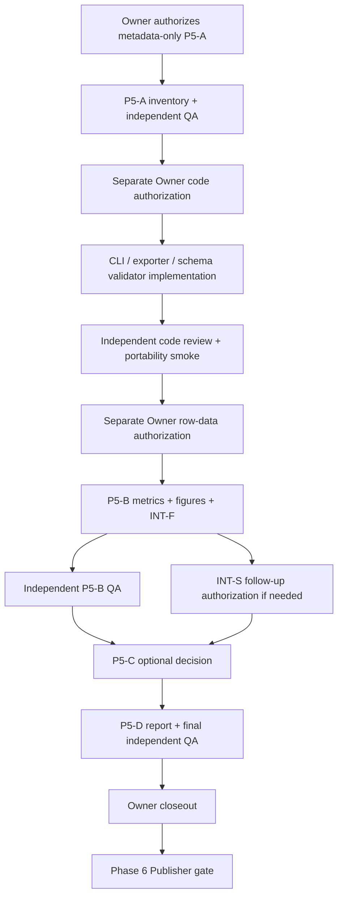

# Phase 5 Python CLI and evaluation engineering blueprint

**Status: PROPOSED / NOT IMPLEMENTED.** This is a docs-only design for future work under Issue [#37](https://github.com/wupojung/AIoT-HW2-Housing-Regression/issues/37). No CLI, exporter, schema validator, bundle validator, host preflight, or real evaluation is claimed to exist. A later Owner authorization must define the actual code and data gates.

## 1. Scope and authority

The future Phase 5 producer has a narrow responsibility: create and validate Phase 5 artifacts under the Case Package's `phases/phase-05/` namespace, with private evidence and checkpoints kept in a separately authorized private staging area. It must not fabricate upstream Case or Phase 4 records, silently inspect local research data, or publish assets.

Apply these sources in order:

| Source | Authority for this plan | Status |
|---|---|---|
| Issue #37 body and first acceptance comment | Research scope, gates, acceptance, safety | Governing task specification; no execution permission by itself |
| PM review comment #6419882540 | Required schedule and S1–S5 planning decisions | Planning corrections; no data or code permission |
| PR #35 Phase 5 Data Contract v1.2 and its schema/samples | Canonical Phase 5 JSON wire format | Accepted design at reviewed HEAD `8d2bc4405e08e1a1b982204984f681d90975956a`; PR remains Draft/open |
| `docs/crisp-dm/04-modeling-p4b-experiment-protocol.md` | Existing fold and metric aggregation semantics | Reference only; do not revise P4 in a Phase 5 change |
| `requirements.lock` at planning BASE | Python dependency versions | `numpy==2.5.4`, `scikit-learn==1.9.1`; do not install or upgrade |

The canonical output wire format is **only** the PR #35 v1.2 contract and its `evaluation-index.schema.json` (JSON Schema Draft 2020-12). The canonical Case-root-relative output path is:

```text
phases/phase-05/evaluations.json
```

Pinned PR #35 references at the reviewed HEAD: [Phase 5 Data Contract v1.2](https://github.com/wupojung/AIoT-HW2-Housing-Regression/blob/8d2bc4405e08e1a1b982204984f681d90975956a/docs/ui-ux/case-package/phase-05/PHASE-05-DATA-CONTRACT-v1.md), [evaluation schema](https://github.com/wupojung/AIoT-HW2-Housing-Regression/blob/8d2bc4405e08e1a1b982204984f681d90975956a/docs/ui-ux/case-package/phase-05/evaluation-index.schema.json), [empty sample](https://github.com/wupojung/AIoT-HW2-Housing-Regression/blob/8d2bc4405e08e1a1b982204984f681d90975956a/docs/ui-ux/case-package/phase-05/sample/evaluations.json), [synthetic nonempty sample](https://github.com/wupojung/AIoT-HW2-Housing-Regression/blob/8d2bc4405e08e1a1b982204984f681d90975956a/docs/ui-ux/case-package/phase-05/sample/evaluations.nonempty.mock.json), and [Validation Matrix](https://github.com/wupojung/AIoT-HW2-Housing-Regression/blob/8d2bc4405e08e1a1b982204984f681d90975956a/docs/ui-ux/case-package/phase-05/VALIDATION-MATRIX.md). These links pin the planning inputs; PR #35 is not merged.

Issue #37 §15's `evaluations.v1.json` / `schema_version=1.1.0` examples are **historical and superseded for active Phase 5 output**. PM has already corrected Checklist J09 in comment [#6419852505](https://github.com/wupojung/AIoT-HW2-Housing-Regression/issues/37#issuecomment-6419852505) to name `phases/phase-05/evaluations.json` as the one active wire path and keep release sealing/projection with Phase 6. The updated checklist is authoritative for this plan. The accepted contract's `schema_version` is `1.0.0`; do not create a second Phase 5 wire format or translate to the old path in this CLI.

| Wire-format question | Active decision |
|---|---|
| Canonical file | Case-root-relative `phases/phase-05/evaluations.json` |
| Contract/schema | PR #35 Phase 5 v1.2; `evaluation-index.schema.json`, JSON Schema Draft 2020-12, `schema_version: "1.0.0"` |
| Empty authorized result | `status: "UNAVAILABLE"`, specific `reason_code`, `evaluations: []`, `default_evaluation_id: null`; schema validation still required |
| Related evaluation records | Each record has its own `evaluation_id`; `cv_fold_mean` and `pooled_oof` are separate `metric_source`/evaluation records. Join only through reviewed `linked_evaluation_ids[]` allowed by the contract. |
| Historical references | Issue §15 `evaluations.v1.json` / v1.1.0 and Checklist J09's old projection are superseded. No legacy output is generated. |

**J09 status:** corrected by PM before this planning PR. This PR records the resulting decision and does not update Issue #37 or its acceptance comment.

Within a canonical evaluation record, `metrics` may contain exactly `mae`, `rmse`, and `r2`. The accepted schema forbids extra properties. MAPE and MedAE remain conditional analysis candidates under Issue #37; they must not be serialized into canonical `metrics` unless the contract is separately revised and accepted. No new schema or duplicate JSON Schema is proposed here.

## 2. Required sequence and ownership



| Order | Work | Producer owns | Independent check / exit | Permission boundary |
|---|---|---|---|---|
| 1 | P5-A metadata inventory | `evidence-inventory.json` (including `source_key_mappings[]`), `gap-permission-matrix.json`, `checkpoint.json` | A separate Reviewer records PASS/PARTIAL/BLOCKED and artifact digests in the authorized review channel. No fourth QA JSON is required at A. | Owner must authorize exact metadata, host, paths, and writes. No row-level OOF or Holdout access. |
| 2 | CLI engineering gate | Cross-platform Python module, exporter, JSON Schema validation, tests on synthetic fixtures | Reviewer is not the Producer; code review and bounded portability smoke precede real P5-B. | Separate Owner code authorization. It does not grant any row-data permission. |
| 3 | P5-B core evaluation + INT-F | MAE/RMSE/R², three core figure slots/assets when legally available, manifest, interval feasibility memo, canonical private `evaluations.json` | A distinct Reviewer verifies provenance, metric source/population, figure conventions, and artifact digests; records a checkpoint/review result. | P5-A PASS, tool ready, and a separate Owner gate for the exact row sources and processing. |
| 4 | INT-S, if necessary | Actual statistically justified CI/PI figure and evidence | Independent scientific review and Owner decision | Separate method/data/compute gate; INT-F cannot substitute for INT-S. |
| 5 | P5-C | Adopt/defer/N/A matrix for conditional and optional diagnostics | Reviewer accepts rationale; no optional diagnostic is mandatory by default | Any new source or computation needs its own authorization. |
| 6 | P5-D | Traditional Chinese report, private handoff manifest, final `qa-report.json`, checkpoint | Final QA by a Reviewer distinct from Producer, then Owner closeout | No public release or Phase 6 action implied. If INT-S is incomplete, HW2 fully-ready remains NO. |
| 7 | Phase 6 Publisher | Public projection, release sealing, static hosting | Separate release QA | Independent #34 authorization. |

The CLI engineering gate is an engineering prerequisite inserted between P5-A and actual P5-B row processing. It is not an additional research Gate and does not change P5-A/B/C/D terminology in Issue #37. Documentation readiness never means runtime readiness.

## 3. Input manifest and provenance contract (proposed)

The future CLI accepts an explicit manifest path; it never scans disks, guesses aliases, downloads inputs, or infers permissions. The exact file schema and flag names require a later code PR, but that PR must preserve this field classification:

| Class | Proposed fields | Rule when absent or inconsistent |
|---|---|---|
| **REQUIRED** | `case_id`, target column/unit, requested operation (`preflight`, `validate`, or `export`), output root, explicit input allowlist, owner gate record reference, selected host identity/OS family, repository HEAD, and required CLI arguments | Missing field, absent permission, invalid path, host mismatch, or missing gate is nonzero STOP with checkpoint; never convert to a successful empty result. |
| **REQUIRED for each source** | Source artifact identifier, authorized source reference, SHA-256, read permission level, verification status, and source-to-canonical key mapping | Hash mismatch or insufficient access is nonzero STOP. Do not open row content to discover metadata when only metadata permission exists. |
| **REQUIRED for P5-B** | Explicit prediction/metric source, evaluation population, execution/configuration/protocol identity where verifiable, expected target and units, fold membership/provenance when fold metrics are requested, source files and digests, and row-processing authorization | Unknown identifiers that would create an unsafe join remain UNKNOWN and block that join. Missing legal rows means UNAVAILABLE only if authorized preflight was otherwise valid. |
| **REQUIRED for figure export** | Figure identity, owning `evaluation_id`, axes/units, residual convention, source evaluation, asset output allowlist, source digest, and publication review state | Missing source or publication review leaves figure UNAVAILABLE/PENDING; no fabricated asset or public reference. |
| **OPTIONAL** | Approved existing Case root, `package.json`, `case.json`, Phase 4 catalog, already-approved figure/table inputs, report metadata | Omission may allow a Phase 5 fragment only; it cannot imply full Case Package integration. |
| **DERIVED** | Canonical Phase 5 output paths, metric values from authorized predictions, residual=`actual - predicted`, fold means and sample SD from per-fold values, artifact SHA-256 and byte counts | Derive only from explicitly authorized, validated inputs; record exact parents/versions. Derived identity must not invent a Phase 4 run/config/model ID. |
| **UNKNOWN until upstream owner confirms** | Phase 4 JSON field paths, registry model IDs, final-fit ID, legacy `run_id` mapping, unavailable source artifact keys, unapproved Phase 4 JSON examples | Preserve UNKNOWN/null with reason. A guessed alias cannot be joined or marked VERIFIED. |

The P5-A `source_key_mappings[]` embedded in `evidence-inventory.json` is the one authority for source-to-canonical mapping, per PM D-01 Option A. A separate mapping file is not a required artifact and may only be a derived view with `parent_inventory_sha256` if a later approved consumer needs it. Phase 4 schema/sample fields in PR #35 are illustrative/unapproved unless an upstream Owner accepts them. Do not claim private CSV/JSON summaries form a stable Case Package contract.

### Identity and joins

- Preserve the canonical relation `case_id → execution_run_id → configuration_id → evaluation_id`; an evaluation also fixes one population, prediction origin, metric source, protocol and evidence version.
- `final_fit_id`, `model_id`, and `model_version` remain null unless backed by an approved upstream registry/source.
- A legacy `run_id` must be mapped by evidence before use. If case/config/track/protocol/population/version disagree, stop with `JOIN_BLOCKED`.
- CV fold-mean KPIs (`metric_source: cv_fold_mean`) and pooled OOF diagnostics (`metric_source: pooled_oof`) are separate evaluations with distinct `evaluation_id` values and one `metric_source` per evaluation. Link them only using reviewed `linked_evaluation_ids[]` when the identity contract permits it.
- Holdout aggregate metrics cannot be joined to row-level OOF figures. A private row-level source never becomes public just because it produced a PNG.

## 4. Output ownership, empty state, and package integration

### Phase 5 namespace

The producer owns only these Phase 5 artifacts when needed and authorized:

```text
<case-root>/phases/phase-05/evaluations.json     # required canonical index, even when empty
<case-root>/phases/phase-05/evaluations/         # optional detail files with real records
<case-root>/phases/phase-05/figures/             # optional approved real figure files
<case-root>/phases/phase-05/tables/              # optional approved accessible summaries
<private-staging-root>/<gate-id>/                # private evidence, checkpoints, QA material
```

`evaluations.json` must follow PR #35 v1.2. For valid authorized preflight with no approved evaluation, the producer emits schema-valid `status=UNAVAILABLE`, a specific `reason_code`, `evaluations: []`, and no default evaluation or fake figures; this is exit 0 because the authorized request completed honestly. The empty case never grants access or bypasses preflight.

Missing authorization, denied permission, missing required arguments, invalid/escaping paths, hash mismatch, wrong host, wrong Case identity, invalid required manifest, or schema failure returns nonzero and a checkpoint/error. In those cases do not write a normal-looking successful Case Package or claim the empty state is valid. Do not overwrite source files, a previous completed export, or sealed immutable releases. Stage to a unique run directory and promote atomically only after validation; if destination exists, fail closed unless a documented safe resume proves identical gate, inputs, hashes, protocol and Git HEAD.

### Upstream package boundary (S5)

`package.json`, `case.json`, and `phases/phase-04/modeling.json` are owned by approved upstream sources or a separately authorized Phase 6 assembler. The Phase 5 CLI must not create or repair them. If these roots are absent but the required Phase 5 inputs and gate are valid, the CLI may produce a **Phase 5 fragment** with `PACKAGE_INTEGRATION_PENDING`; it must not call that a complete Case Package, publish PASS, or release-ready output. If even the Phase 5 authorization/inputs are incomplete, fail closed instead of producing a fragment.

All paths stored in the canonical index are Case-root-relative, use forward slashes, and cannot traverse (`..`), escape through a symlink, or point outside the approved allowlist. Public references require review and same-release SHA verification. Private research materials remain outside public package roots. P5 export and evaluation run offline on the Owner-selected authorized host; Vercel serves only approved static JSON/figure assets from one immutable release. Do not run CV, OOF processing, or sklearn evaluation inside a request handler; prediction API work belongs to a separate Phase 6 gate.

## 5. Proposed command and state machine

The repository currently has a `python/src/` layout and `python/src/environment_check.py`, but no tracked `pyproject.toml`, `setup.py`, `setup.cfg`, `__main__.py`, or registered CLI. The environment check only imports dependencies. Therefore neither `python -m housing_regression.phase5_cli` nor any command below runs from a clean checkout today.

**Proposed packaging decision for the future code PR:** add packaging metadata at `python/pyproject.toml`, declare `python/src` as the package root, and expose the CLI as the `housing_regression.phase5_cli` module with a `main()` entry function. Keep dependency pins in the repository lock; do not add or upgrade dependencies as part of this docs plan. The future code PR must separately authorize any install into a venv and record its exact command. After that approved packaging setup, the proposed working directory is the repository root, where the installed package resolves to `python/src` and the module command below may be used. Before packaging is implemented and verified, an explicit `PYTHONPATH=python/src` (or Windows equivalent) would be required for source-tree imports. Both setup and module invocation remain **PROPOSED / NOT IMPLEMENTED**.

The future implementation PR must pin and verify the exact working directory, package/import path, interpreter, `--help` behavior, and command. Do not report that the module command runs merely because Python and dependencies import successfully.

```text
PROPOSED / NOT IMPLEMENTED
<python> -m housing_regression.phase5_cli --help
<python> -m housing_regression.phase5_cli preflight --manifest <authorized-input.json> --gate <gate-record.json>
<python> -m housing_regression.phase5_cli validate --manifest <authorized-input.json> --case-root <case-root>
<python> -m housing_regression.phase5_cli export --manifest <authorized-input.json> --gate <gate-record.json> --output-root <private-staging-root>
```

Use the invoking interpreter as `sys.executable`; resolve paths with `pathlib`, serialize UTF-8, and use same-volume atomic promotion. The implementation must not add dependencies or change the lock without a separate decision. Each command supports an explicit working directory, paths, Case ID, mode and output root; no implicit current-directory search, secret-bearing shell command, network fetch, auto-install, model fit, or fallback host.

State transitions:

```text
NOT_AUTHORIZED → PREFLIGHT → RUNNING → VALIDATING → AWAITING_INDEPENDENT_QA → QA_PASS/PARTIAL → AWAITING_OWNER_CLOSEOUT
                     ↘ DENIED / HASH_MISMATCH / HOST_MISMATCH / JOIN_BLOCKED / SCHEMA_FAIL → BLOCKED checkpoint
```

Preflight verifies gate reference, host/OS/HEAD/env, required arguments, path containment, allowlists, permission levels, source digests and expected identities before reading permitted content. Export validates canonical JSON Schema, then physical artifacts and same-Case joins required by the authorized scope. It records a checkpoint, output inventory, schema result, source/output digests, exit code and next safe action. The Producer cannot write an independent QA PASS.

The first complete bundle may only be called a `Phase5 fragment` unless validated upstream roots are present and an authorized bundle validator verifies their joins. Schema validity alone does not prove cross-file identity, physical file existence, SHA, publication rights, scientific validity, or a complete Case Package.

## 6. Metrics and scientific semantics

### Locked API and P4 compatibility

`requirements.lock` fixes NumPy 2.5.4 and scikit-learn 1.9.1. The planning venv has been reported to import these versions and expose the needed metric functions; this is local environment evidence only, not cross-platform QA and not an evaluation of real data. Do not install, upgrade, or infer portability from that observation.

Keep the existing P4 [`_metric_values`](../../../../python/src/housing_regression/modeling/p4b_v2.py) semantics without changing P4:

- Reject non-finite predictions before metric calculation.
- Define residual as `actual - predicted`.
- MAE is mean absolute residual in target units.
- RMSE is the square root of mean squared residual in target units. MSE is only the intermediate for RMSE, not an additional canonical metric.
- R² is `1 - SSE/SST`; a constant target has `SST == 0` and is unavailable, matching P4's `None` behavior.
- Canonical JSON contains only `mae`, `rmse`, and `r2`. The v1.2 schema forbids extra metric properties. MAPE and MedAE are conditional candidates only and require a separate accepted contract change before they can be emitted.

For the future implementation use only APIs present in the locked scikit-learn version: `mean_absolute_error`, `mean_squared_error`, `root_mean_squared_error`, `r2_score`, and, if a separately approved conditional-metric report is ever required, `mean_absolute_percentage_error` and `median_absolute_error`. Prefer `root_mean_squared_error`; if a compatibility path is needed, compute `sqrt(mean_squared_error(...))`. Do not publish MSE as a fourth metric.

R² must be evaluated with `force_finite=False`. If the target is constant or the returned score is non-finite, set canonical `r2` to `null` with an UNAVAILABLE reason; do not rely on scikit-learn's default finite replacement of undefined constant-target scores. MAE/RMSE require finite, aligned actual/predicted arrays and the same target scale. If targets are transformed, state the scale and do not compare transformed and original-unit values.

MAPE uses scikit-learn's relative 0–1 convention (multiply by 100 only for presentation outside the canonical JSON); zero or near-zero targets make it unstable and must be treated as a caveat/eligibility check. MedAE is also outside the canonical schema. Neither is auto-enabled for Ames nor written to `evaluations.json`.

### Fold mean, sample SD and pooled OOF are distinct

Follow P4-B Protocol v2: compute the metric separately on each validation fold. For each of MAE, RMSE and R², record the arithmetic fold mean and sample standard deviation with NumPy `ddof=1`; retain per-fold values and fold count. Do not compute a pooled score and label it a fold mean. Pooled OOF metrics are calculated once across concatenated valid OOF predictions and belong to a different `evaluation_id`/`metric_source`; never use pooled values as fold SD inputs. Keep fold-mean and pooled OOF evaluations distinct even though both can describe Development OOF.

The following deterministic synthetic-only example gives explicit expected values. It must remain documentation-only until a later code gate; it does not read any Case data:

```python
import numpy as np
from sklearn.metrics import (
    mean_absolute_error,
    mean_squared_error,
    r2_score,
    root_mean_squared_error,
)

y_true = np.array([100.0, 150.0, 200.0])
y_pred = np.array([110.0, 130.0, 210.0])
residual = y_true - y_pred

mae = mean_absolute_error(y_true, y_pred)       # 13.333333 USD
mse = mean_squared_error(y_true, y_pred)         # 200 USD^2; intermediate only
rmse = root_mean_squared_error(y_true, y_pred)   # 14.142136 USD
r2 = r2_score(y_true, y_pred, force_finite=False)  # 0.88

fold_mae = np.array([0.0, 1.0, 2.0])
fold_mean_mae = float(np.mean(fold_mae))         # 1.0
fold_sample_sd_mae = float(np.std(fold_mae, ddof=1))  # 1.0
```

For this fixture residual is `[-10.0, 20.0, -10.0]`; a negative residual means overprediction and a positive residual means underprediction. MAPE for this fixture is `0.094444` (relative fraction; `9.4444%` only when formatted for display) and MedAE is `10 USD`; these two values are optional conditional research examples and are not fields in canonical JSON. The shown fold values are a separate synthetic example and are not derived from the three-row pooled fixture. The accepted contract represents `fold_summary.sample_sd` as `{mae, rmse, r2}` and requires `ddof: 1`; it does not allow an unlabeled scalar SD. If fewer than two valid fold values exist, sample SD is UNAVAILABLE rather than zero. Record expected and observed fold counts.

For R², also report UNAVAILABLE when `n < 2`, the target is constant, or `force_finite=False` produces a non-finite result. Do not let scikit-learn's default `force_finite=True` replacement (`0` or `1`) appear as an empirical score in these cases.

### Versioned official references

- Locked source: [`requirements.lock`](../../../../requirements.lock) at the planning BASE.
- scikit-learn 1.9.1 regression implementation: [`sklearn/metrics/_regression.py`](https://github.com/scikit-learn/scikit-learn/blob/1.9.1/sklearn/metrics/_regression.py).
- API references: [`mean_absolute_error`](https://scikit-learn.org/1.9/modules/generated/sklearn.metrics.mean_absolute_error.html), [`mean_squared_error`](https://scikit-learn.org/1.9/modules/generated/sklearn.metrics.mean_squared_error.html), [`root_mean_squared_error`](https://scikit-learn.org/1.9/modules/generated/sklearn.metrics.root_mean_squared_error.html), [`r2_score`](https://scikit-learn.org/1.9/modules/generated/sklearn.metrics.r2_score.html), [`mean_absolute_percentage_error`](https://scikit-learn.org/1.9/modules/generated/sklearn.metrics.mean_absolute_percentage_error.html), and [`median_absolute_error`](https://scikit-learn.org/1.9/modules/generated/sklearn.metrics.median_absolute_error.html).
- NumPy 2.5 API references: [`numpy.mean`](https://numpy.org/doc/2.5/reference/generated/numpy.mean.html) and [`numpy.std`](https://numpy.org/doc/2.5/reference/generated/numpy.std.html); `ddof=1` is the sample-SD choice.
- Project aggregation rule: [`P4-B experiment protocol v2`](../../../crisp-dm/04-modeling-p4b-experiment-protocol.md), particularly its three-fold reporting and prohibition on labeling pooled OOF RMSE as mean-fold RMSE.

## 7. Figure and interval contract

Create figures only from a single explicitly authorized and validated evaluation population. Each figure belongs to its own `evaluation_id` and carries source digest, identity, `n`, prediction origin, metric source, publication state, axis labels/units, alt text, and accessible table reference where required. No raw restricted row points or private paths may appear in public JSON or assets.

| Figure | Canonical meaning | Minimum plan checks |
|---|---|---|
| FIG-P5-01 | X=actual, Y=predicted, same target units, `y=x` reference | One population/config only; identify OOF vs aggregate Holdout; include `n` and source evidence. |
| FIG-P5-02 | X=predicted, Y=`actual - predicted`, `y=0`; highest priority | Positive means underprediction; negative means overprediction; label exact population and prediction origin. |
| FIG-P5-03 | Residual histogram, zero reference, explicit bin rule and `n` | A histogram is not a normality test; do not confuse target outliers with residual outliers. |
| FIG-P5-04 | Actual confidence/prediction interval evidence only after INT-S | Feasibility memo (INT-F) and actual interval deliverable (INT-S) are separate; a memo or `RMSE × constant` is not a PI. |

If an approved source or rights review is missing, the figure is UNAVAILABLE/PENDING and no fake image is generated. `INT-F PASS` means feasibility was reviewed; only a valid, independently reviewed actual interval figure/evidence can make INT-S PASS. If INT-S remains unresolved, record the HW2 submission blocker and do not claim fully ready.

## 8. Error handling, retry, resume, and STOP matrix

| Condition | Result | Writes allowed |
|---|---|---|
| Valid authorized gate/input/host; no approved evaluations | Exit 0; schema-valid UNAVAILABLE empty index | Phase 5 empty output plus private checkpoint in authorized staging |
| Missing gate/permission/required arguments | Nonzero; `NOT_AUTHORIZED` or `INVALID_INPUT` checkpoint | Private checkpoint only if that write is explicitly allowlisted; no successful package/index |
| Host, repo HEAD, environment, Case ID or source SHA mismatch | Nonzero; `HOST_MISMATCH`, `HEAD_MISMATCH`, `CASE_MISMATCH` or `HASH_MISMATCH` | Allowlisted private checkpoint only; no export |
| Unsafe path, traversal, symlink escape or path outside allowlist | Nonzero; `PATH_BLOCKED` | No target write; checkpoint only to safe preauthorized location |
| Unknown legacy ID or incompatible case/config/population/source join | Nonzero; `JOIN_BLOCKED` | Diagnostic checkpoint; no VERIFIED record |
| Schema, asset SHA, physical path or same-release check fails | Nonzero; `SCHEMA_FAIL` or `BUNDLE_INVALID` | Keep isolated failed staging evidence; no promotion |
| Permission denied, unexpected sensitive data, or scope requires new rows/fit/calibration | STOP and request a new Owner gate | No retry or widening of allowlist |
| Transient I/O during staged output | At most two bounded retries if safe and explicitly documented | Unique temporary path; never overwrite a source or completed/sealed artifact |

Resume only when the gate ID, complete input hashes, protocol, host/environment, Git HEAD and operation match the checkpoint. A resume cannot broaden permissions. No automatic package download, dependency install, disk scan, model fit, Holdout access, repeated worker launch, or silent switch to another OS.

## 9. Test and QA plan (all proposed; NOT IMPLEMENTED)

No tests are run by this planning document. Once separately authorized, implementation work should use synthetic fixtures and these bounded categories:

| Layer | Required cases | Proposed command / acceptance |
|---|---|---|
| Unit | Validated argument parsing; root containment; hashes; IDs; `actual-predicted`; finite inputs; constant-target / `n < 2` / non-finite R² UNAVAILABLE; MAE/RMSE/R² expected values; fold mean/sample SD `ddof=1`; fewer than two valid folds means sample SD unavailable | `python -m pytest -q tests/phase5/test_metrics.py tests/phase5/test_preflight.py` (proposed test modules; not present) |
| Schema | Empty UNAVAILABLE index; nonempty synthetic MOCK; only three allowed metric keys; reject extra `mape`/`medae`; null+reason; safe refs; INT-F/INT-S split | `python -m pytest -q tests/phase5/test_schema.py` and proposed CLI `python -m housing_regression.phase5_cli validate --manifest tests/fixtures/phase5/empty.json --schema <pinned-v1.2-schema>` (test/module/fixture not present; CLI invocation depends on future packaging setup) |
| Integration | Authorized synthetic manifest to Phase 5 fragment; JSON/schema plus asset paths/SHA and identity joins; reject mismatch and missing upstream package roots with `PACKAGE_INTEGRATION_PENDING` | `python -m pytest -q tests/phase5/test_export_integration.py` (proposed test module; not present) |
| Scientific QA | Metric definitions, target units/scale, fold mean vs pooled OOF separation, residual sign, one evaluation per source/population, no OOF-as-Holdout labeling, interval claims | Reviewer uses fixed synthetic values and evidence table; never uses Ames or private data in this test layer. |
| Portability | Same synthetic preflight/JSON/path/UTF-8 fixture on Linux, Windows and macOS; `--help`; no platform-specific required shell or path assumption | After future package setup, from repository-root working directory: `python -m housing_regression.phase5_cli --help`, then focused pytest commands on each authorized test host (proposed; CLI absent). Linux+Windows CI and sourced macOS smoke may be sufficient; no 96-task matrix. |
| Release QA | No release action in this engineering gate; verify manifest references, file hashes, rights, same-release IDs and public/private separation against synthetic package | `python -m pytest -q tests/phase5/test_release_manifest.py` (proposed test module; not present); publication remains a separate #34 gate. |

Do not add broad CI triggers or run the full repository suite by default. The repo's owner-controlled CI rule keeps PRs to `main` from automatically running the full Security/pytest workflow; only the authorized `deploy` release path or explicit `workflow_dispatch` may do so. Never silently rerun a failed/historical check. A schema-only pass cannot establish exporter, bundle, scientific, or publication correctness.

## 10. Artifact and checkpoint inventory

| Artifact | Gate | Visibility | Notes |
|---|---|---|---|
| `evidence-inventory.json` | P5-A | Private | Contains source keys and digests; mapping array is embedded here. |
| `gap-permission-matrix.json` | P5-A | Private | Distinguishes verified, derivable, separately authorized, unavailable, and prohibited. |
| `checkpoint.json` | Every gate | Private | State, authorization, host/HEAD, inputs/outputs, digests, exit code, stop reason, next safe action. |
| `phases/phase-05/evaluations.json` | Engineering fixture/P5-B | Private until separately reviewed | Canonical PR #35 v1.2 path/schema; required empty state when authorized and no eligible evaluations. |
| `evaluation-metrics.json` and `figure-manifest.json` | P5-B | Private | Only authorized and provenance-backed metrics/assets; cannot add MAPE/MedAE to canonical `metrics`. |
| `evaluation-report.md` | P5-D | Private draft until review | Traditional Chinese report, sourced findings and limitations. |
| `qa-report.json` | Final P5-D | Private | Written by an independent Reviewer, never the Producer. Earlier gate QA may be review-channel report plus artifact digests. |
| Public projection / release manifest | Phase 6 | Public only after approval | Separate Publisher/Owner gate; same immutable release, allowlist, SHA and rights. |

## 11. Go/no-go for a future implementation handoff

Proceed to a code PR only after a separate Owner authorization identifies the exact files, branch, test scope and stop condition. That code task may implement the CLI/schema tooling against synthetic fixtures without real data. Proceed to actual P5-B only after P5-A independent QA, separate row-level Owner authorization, a verified host/input allowlist and a reviewed implementation/tool environment. If any required ID, source, permission, hash, target, population, or upstream contract is unknown, preserve UNKNOWN and stop before unsafe read/join/export.

**Current planning result:** this document proposes a complete implementation handoff; it does not claim implementation readiness, data authorization, P5-A runtime PASS, P5-B results, INT-S completion, publication, or Phase 5 closeout.
